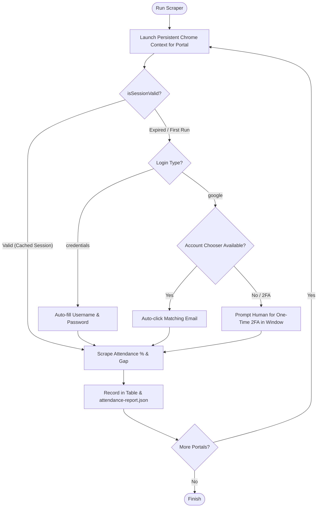

# Uniflow Multi-Portal Attendance Automation

A robust **Node.js + Playwright** automation tool that logs into multiple university student portals, extracts attendance metrics (overall attendance percentage, attendance margin gap), and generates structured reports.

Human intervention is required **only once per portal** (on the first run to complete manual login / Google 2FA). Every subsequent run is **fully automatic** using persistent browser profiles.

---

## Key Features

- 🔄 **One-Time Human Login**: Authenticate once (including 2FA/CAPTCHA), and Playwright preserves the authenticated session cookies and local storage indefinitely in `./profiles/<portal-name>/`.
- ⚡ **Zero-Overhead Session Validation**: On every run, the engine checks session validity before touching login pages. If the session is alive, it skips authentication entirely and goes straight to data extraction.
- 🔀 **Flexible Auth Support**:
  - **Credentials-based**: Automates username/password form submission from `.env`.
  - **Google Sign-In / SSO**: Launches real Google Chrome with stealth flags, supports Google Account Chooser auto-selection, and pauses gracefully for one-time 2FA if needed.
- 📋 **Config-Driven**: Define portals cleanly in `portals.config.js` with selectors, custom URLs, or optional custom scrapers.
- 📊 **Automated Reporting**: Outputs a formatted `console.table()` summary and persists historical metrics into `attendance-report.json`.
- 🛡️ **Stealth Anti-Detection**: Disables automation blink flags, removes `navigator.webdriver`, and runs real Chrome (`channel: 'chrome'`) to prevent Google bot blocking.

---

## Installation

### 1. Prerequisites
- [Node.js](https://nodejs.org/) (v18 or higher recommended)
- Google Chrome installed on your system (for real Chrome channel)

### 2. Install Dependencies
In the project directory:

```bash
npm install
```

*(Optional: If Playwright browsers need to be installed, run `npx playwright install chromium`)*

---

## Configuration

### 1. Environment Secrets (`.env`)
Copy `.env.example` to `.env`:

```bash
cp .env.example .env
```

Edit `.env` with your student credentials:

```env
# Default student credentials
UNIV_EMAIL=your_student_email@university.edu.pk
UNIV_PASSWORD=your_secure_password

# General Settings
HEADLESS=false
DEFAULT_TIMEOUT_MS=60000
MANUAL_LOGIN_TIMEOUT_MS=120000
```

> **Note**: Per-portal credentials overrides are supported. For example, if a specific portal uses different credentials, set `AIR_UNIV_EMAIL=...` and point to it in `portals.config.js`.

### 2. Portal Configuration (`portals.config.js`)
Edit [portals.config.js](file:///d:/Ahmed%20Dev/Projects/Uniflow/portals.config.js) to configure your university portals:

```javascript
export const portals = [
  {
    name: 'StudentPortal_Credentials',
    description: 'Air University Student Portal',
    url: 'https://portals.au.edu.pk/students/',
    dashboardUrl: 'https://portals.au.edu.pk/students/dashboard.aspx',
    attendanceUrl: 'https://portals.au.edu.pk/students/attendance.aspx',
    loginType: 'credentials',
    selectors: {
      usernameInput: 'input[name="txtRegNo"]',
      passwordInput: 'input[name="txtPassword"]',
      submitButton: 'input[type="submit"]',
      sessionValidation: '#ctl00_lblUserName',
      loginIndicator: 'input[name="txtPassword"]',
      attendancePercent: '#ctl00_MainContent_lblOverallAttendance',
      attendanceGap: '#ctl00_MainContent_lblAttendanceGap',
    }
  },
  {
    name: 'UniversityLMS_Google',
    description: 'University LMS with Google Sign-In',
    url: 'https://lms.university.edu.pk/login',
    dashboardUrl: 'https://lms.university.edu.pk/my/',
    attendanceUrl: 'https://lms.university.edu.pk/mod/attendance/index.php',
    loginType: 'google',
    selectors: {
      googleSignInButton: 'a.btn-google',
      googleAccountChooserSelector: 'div[data-identifier="{EMAIL}"]',
      sessionValidation: '.userbutton',
      loginIndicator: 'a.btn-google',
      attendancePercent: '.att-summary-percentage',
      attendanceGap: '.att-summary-gap',
    }
  }
];
```

---

## How It Works



### First-Run Behavior
1. The browser launches in headful mode.
2. If Google SSO or 2FA is required, the terminal displays:
   ```
   ==============================================================================
   🔔 FIRST-TIME GOOGLE LOGIN REQUIRED FOR "UniversityLMS_Google"
   👉 Please complete your sign-in and 2FA in the opened browser window.
   ⏳ The scraper will automatically resume once logged in (timeout: 120s)...
   ==============================================================================
   ```
3. You perform the login / 2FA in the browser window.
4. Once completed, your authenticated profile is stored in `./profiles/<portal-name>/`.

### Subsequent Runs (Fully Automatic)
- On future runs, `isSessionValid()` loads the portal dashboard directly.
- The session is detected as active, skipping login prompts and Google auth entirely.
- Attendance metrics are scraped in seconds.

---

## Usage

### Run All Configured Portals
```bash
npm start
# or
node index.js
```

### Run a Single Specific Portal (for Testing)
```bash
node index.js --portal StudentPortal_Credentials
```

---

## Output & Report Format

### Console Output
```text
━━━━━━━━━━━━━━━━━━━━━━━━━━━━━━━━━━━━━━━━━━━━━━━━━━━━━━━━━━━━━━━━━━━━━━━━━━━━━━━━
📊 ATTENDANCE SUMMARY REPORT
━━━━━━━━━━━━━━━━━━━━━━━━━━━━━━━━━━━━━━━━━━━━━━━━━━━━━━━━━━━━━━━━━━━━━━━━━━━━━━━━
┌─────────┬────────────────────────────┬──────────────┬────────────────┬──────────┬────────┐
│ (index) │ Portal                     │ Status       │ Attendance %   │ Gap      │ Error  │
├─────────┼────────────────────────────┼──────────────┼────────────────┼──────────┼────────┤
│ 0       │ StudentPortal_Credentials  │ ✅ SUCCESS   │ 87.5%          │ +3 safe  │ -      │
│ 1       │ UniversityLMS_Google       │ ✅ SUCCESS   │ 92.0%          │ +5 safe  │ -      │
└─────────┴────────────────────────────┴──────────────┴────────────────┴──────────┴────────┘
```

### JSON Report (`attendance-report.json`)
The script writes and maintains historical snapshots:
```json
{
  "lastUpdated": "2026-09-27T04:55:00.000Z",
  "summary": {
    "totalPortals": 2,
    "successful": 2,
    "failed": 0
  },
  "results": [
    {
      "portal": "StudentPortal_Credentials",
      "status": "SUCCESS",
      "latestPercent": "87.5%",
      "gap": "+3 safe",
      "scrapedAt": "2026-09-27T04:54:55.123Z",
      "error": null
    }
  ],
  "history": [ ... ]
}
```

---

## Adding a New Portal

1. Open [portals.config.js](file:///d:/Ahmed%20Dev/Projects/Uniflow/portals.config.js).
2. Append a new object to the `portals` array:
   - Provide a unique `name`.
   - Set `loginType` to `"credentials"` or `"google"`.
   - Fill in the relevant selectors for login inputs, session indicator, and attendance values.
3. Test your portal individually:
   ```bash
   node index.js --portal <YourPortalName>
   ```

---

## Scheduling Recurring Runs

### 1. Windows (Task Scheduler)
Create a `.bat` runner script or schedule Node directly:
1. Open **Task Scheduler** (`taskschd.msc`).
2. Click **Create Basic Task** -> Name it `Uniflow Attendance Scraper`.
3. Set Trigger (e.g., Daily at 8:00 AM).
4. Set Action -> **Start a program**:
   - **Program/script**: `C:\Program Files\nodejs\node.exe` (or your node path)
   - **Add arguments**: `index.js`
   - **Start in**: `D:\Ahmed Dev\Projects\Uniflow`
5. Finish the setup.

### 2. Linux / macOS (Cron)
Add a cron job with `crontab -e`:

```bash
# Run daily at 8:00 AM
0 8 * * * cd /path/to/Uniflow && /usr/bin/node index.js >> /path/to/Uniflow/cron.log 2>&1
```

---

## Troubleshooting

- **Google blocks automated login**:
  Ensure you are using `channel: 'chrome'` and `HEADLESS=false` on the first run. The script includes stealth overrides (`navigator.webdriver`) to ensure smooth authentication.
- **Selector changed or missing**:
  If a portal updates its UI, only `latestPercent` and `gap` will fallback to `"N/A"`, without breaking other portals in the batch. Update the corresponding selector in `portals.config.js`.
- **Resetting a Portal's Session**:
  Simply delete the folder `./profiles/<portal-name>/` to start fresh with a new one-time login.
