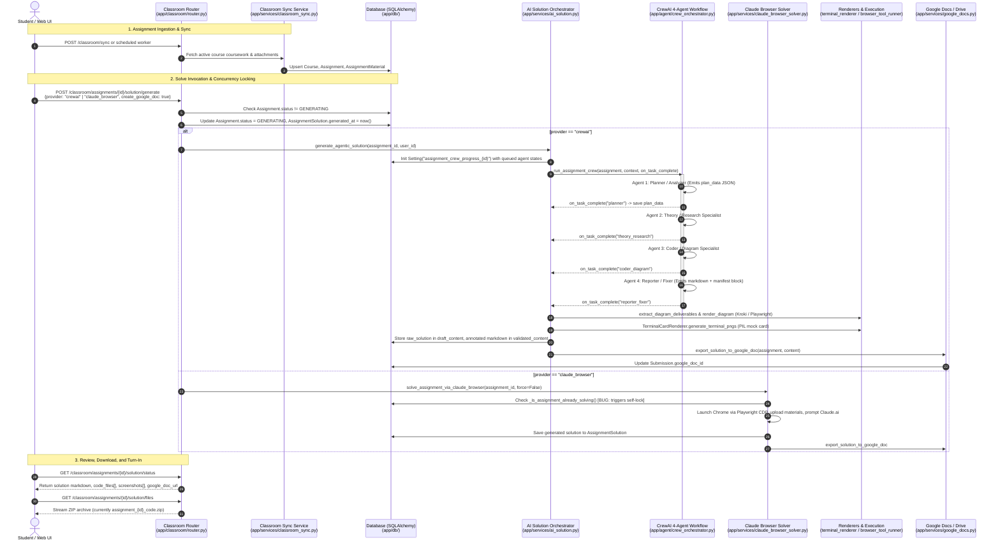

# Uniflow Architecture & Assignment Solving System Specification

**Document Version:** 1.0  
**Status:** Read-Only Audit & Baseline Architecture Document  
**Repository:** `iahmedd-k/UnivFlow`  
**Inspected Date:** October 2026  

---

## 1. Executive Pipeline Architecture

### End-to-End Sequence & Data Flow



---

## 2. Module Map & Responsibilities

| File Path | Primary Responsibility | Key Imports | Imported By |
|---|---|---|---|
| [main.py](file:///d:/Ahmed%20Dev/Projects/Uniflow/backend/app/main.py) | Application root; FastAPI initialization, CORS, middleware, router registration | `app.classroom.router`, `app.assignments.router`, `app.core.config` | Uvicorn / Deployment entrypoint |
| [agent/crew_orchestrator.py](file:///d:/Ahmed%20Dev/Projects/Uniflow/backend/app/agent/crew_orchestrator.py) | CrewAI 4-agent sequential pipeline: `planner`, `theory_research`, `coder_diagram`, `reporter_fixer`. Contains v3 prompts, track classifier, domain playbook, and `run_assignment_crew` | `crewai`, `app.agent.model_registry`, `app.core.config` | `app.services.ai_solution` |
| [agent/model_registry.py](file:///d:/Ahmed%20Dev/Projects/Uniflow/backend/app/agent/model_registry.py) | Model configurations per agent role (Groq/Gemini fallback and name normalization), direct HTTP client | `httpx`, `app.core.config` | `app.agent.crew_orchestrator` |
| [agent/router.py](file:///d:/Ahmed%20Dev/Projects/Uniflow/backend/app/agent/router.py) | REST API endpoints for background sync jobs (`AgentRun`, `AgentEvent`) | `app.db.database`, `app.db.repositories` | `app.main` |
| [classroom/router.py](file:///d:/Ahmed%20Dev/Projects/Uniflow/backend/app/classroom/router.py) | Main user-facing endpoints: coursework sync, material uploads, solution triggers, status polling, file/report downloads | `app.services.ai_solution`, `app.services.claude_browser_solver`, `app.services.terminal_renderer` | `app.main` |
| [services/ai_solution.py](file:///d:/Ahmed%20Dev/Projects/Uniflow/backend/app/services/ai_solution.py) | Core solver coordinator: calls CrewAI, handles multi-stage fallback, parses deliverables, generates diagram/terminal PNGs, and exports to Google Docs | `app.agent.crew_orchestrator`, `app.services.browser_tool_runner`, `app.services.google_docs` | `app.classroom.router`, `app.services.claude_browser_solver` |
| [services/claude_browser_solver.py](file:///d:/Ahmed%20Dev/Projects/Uniflow/backend/app/services/claude_browser_solver.py) | Playwright Chrome CDP solver that automates Claude.ai web UI, materials upload, and prompt submission | `playwright.sync_api`, `app.services.ai_solution`, `app.services.browser_sessions` | `app.classroom.router`, scripts |
| [services/terminal_renderer.py](file:///d:/Ahmed%20Dev/Projects/Uniflow/backend/app/services/terminal_renderer.py) | Pillow (PIL) graphic engine generating high-resolution dark-mode terminal window PNGs from text | `PIL.Image`, `PIL.ImageDraw`, `PIL.ImageFont` | `app.services.ai_solution`, `app.classroom.router`, `app.services.browser_tool_runner` |
| [services/browser_tool_runner.py](file:///d:/Ahmed%20Dev/Projects/Uniflow/backend/app/services/browser_tool_runner.py) | Renders Mermaid / Draw.io XML to PNG via Kroki API or headless Playwright; provides online IDE runner wrappers | `playwright.sync_api`, `httpx`, `app.services.terminal_renderer` | `app.services.ai_solution` |
| [services/google_docs.py](file:///d:/Ahmed%20Dev/Projects/Uniflow/backend/app/services/google_docs.py) | Google Docs v1 and Drive v3 integration; formats academic title pages, body typography, and tables | `googleapiclient.discovery`, `app.db.models` | `app.services.ai_solution`, `app.services.claude_browser_solver`, `app.classroom.router` |
| [assignments/services/solution_generator.py](file:///d:/Ahmed%20Dev/Projects/Uniflow/backend/app/assignments/services/solution_generator.py) | Parallel/competing 7-agent solver (`PlannerAgent`, `WriterAgent`, `CoderAgent`, etc.) using legacy schema | `app.assignments.schemas.assignment` | `app.assignments.services.assignment_service` |
| [assignments/services/assignment_service.py](file:///d:/Ahmed%20Dev/Projects/Uniflow/backend/app/assignments/services/assignment_service.py) | Service orchestrator for the alternate assignments API | `app.assignments.services.solution_generator`, `app.assignments.services.document_parser` | `app.assignments.router` |
| [execution/resolver.py](file:///d:/Ahmed%20Dev/Projects/Uniflow/backend/app/execution/resolver.py) | Engine resolver for code execution (Piston, SQLite, MySQL, MongoDB) | `app.execution.database.*`, `app.execution.programming.*` | `app.execution.router`, `app.services.code_executor` |

---

## 3. Configuration & Model Registry Inventory

### Environment Variables & Settings (`app.core.config.Settings`)

| Setting Key | Env Variable | Default Value | Required in Production | Description / Usage |
|---|---|---|---|---|
| `app_name` | `APP_NAME` | `"Uniflow"` | No | Application display name |
| `environment` | `ENVIRONMENT` | `"development"` | Yes | `"development"` or `"production"` |
| `secret_key` | `SECRET_KEY` | Random 32 bytes (dev) | **Yes** | Cryptographic token signing |
| `encryption_key_v2` | `ENCRYPTION_KEY_V2` | `""` | **Yes** | Fernet encryption key for credentials |
| `database_url` | `DATABASE_URL` | `""` | **Yes** | PostgreSQL connection URI |
| `google_client_id` | `GOOGLE_CLIENT_ID` | `""` | **Yes** | Google OAuth client ID |
| `google_client_secret` | `GOOGLE_CLIENT_SECRET` | `""` | **Yes** | Google OAuth client secret |
| `groq_api_key` | `GROQ_API_KEY` | `""` | Conditional | Required if `ai_provider == "groq"` or for Groq agent roles |
| `gemini_api_key` | `GEMINI_API_KEY` | `""` | Conditional | Required for Gemini agent roles |
| `planner_agent_model` | `PLANNER_AGENT_MODEL` | `"llama-3.3-70b-versatile"` | No | Model for CrewAI `planner` role |
| `theory_agent_model` | `THEORY_AGENT_MODEL` | `"gemini-2.0-flash"` | No | Model for CrewAI `theory_research` role |
| `coder_agent_model` | `CODER_AGENT_MODEL` | `"llama-3.3-70b-versatile"` | No | Model for CrewAI `coder_diagram` role |
| `reporter_agent_model` | `REPORTER_AGENT_MODEL` | `"gemini-2.0-flash"` | No | Model for CrewAI `reporter_fixer` role |
| `claude_enabled` | `CLAUDE_ENABLED` | `False` | No | Flag indicating if Claude is available |
| `browser_service_url` | `BROWSER_SERVICE_URL` | `"http://127.0.0.1:7900"` | No | Hosted browser container API |
| `piston_base_url` | `PISTON_BASE_URL` | `"http://localhost:2000"` | No | Piston remote code execution URL |
| `kroki_base_url` | `KROKI_BASE_URL` | `"https://kroki.io"` | No | Kroki diagram rendering endpoint |
| `redis_url` | `REDIS_URL` | `"redis://localhost:6379/0"` | No | Local Redis broker |
| `upstash_redis_rest_url` | `UPSTASH_REDIS_REST_URL`| `""` | No | Serverless Redis URL |

### CrewAI Agent Role Models (`app/agent/model_registry.py`)

| Agent Role | Assigned Provider | Configured Setting Key | Default Model | Fallback Model (if provider key missing) |
|---|---|---|---|---|
| `planner` | `groq` | `settings.planner_agent_model` | `llama-3.3-70b-versatile` | `gemini/gemini-2.0-flash` |
| `theory_research` | `gemini` | `settings.theory_agent_model` | `gemini-2.0-flash` | `groq/llama-3.3-70b-versatile` |
| `coder_diagram` | `groq` | `settings.coder_agent_model` | `llama-3.3-70b-versatile` | `gemini/gemini-2.0-flash` |
| `reporter_fixer` | `gemini` | `settings.reporter_agent_model` | `gemini-2.0-flash` | `groq/llama-3.3-70b-versatile` |

---

## 4. Plan Data Schema & Proposed Versioning

### Stored Location
Persisted in table `settings`, row key: `assignment_crew_progress_{assignment_id}`.

### Plan Data Schema (`plan_data` / v3 Spec)
```json
{
  "schema_version": "3.0",
  "is_lab": true,
  "track": "A",
  "domain_type": "CODING_LAB",
  "task_type": "LAB_REPORT",
  "deliverable_format": "Standalone Code with Terminal Output",
  "student": {
    "name": "Ali Khan",
    "roll": "210984",
    "course": "Operating Systems",
    "lab": "03"
  },
  "subject": "Process Synchronization with Semaphores",
  "language": "C",
  "summary": "Implement producer-consumer problem using POSIX semaphores and threads.",
  "parts_required": [
    {
      "id": "part_1",
      "title": "Task 1: Producer Consumer Implementation",
      "requirements": "Create two producer and two consumer threads sharing a circular buffer of size 5.",
      "marks": 10,
      "has_questions": true,
      "part_domain": "CODING_LAB",
      "owner": "coder_diagram"
    }
  ],
  "artifacts_required": [
    "code_file",
    "terminal_screenshot"
  ],
  "requires_code": true,
  "requires_terminal_output": true,
  "requires_diagram": false,
  "needs_questions": false,
  "pass_original_unchanged": false,
  "include_code_in_report": true,
  "reference_diagram_available": false,
  "reference_diagram_notes": "",
  "constraints": ["Must use pthread and semaphore.h", "Clean gcc compilation with -Wall"],
  "assumptions": ["Standard Linux POSIX environment"],
  "missing_information": [],
  "tools_required": ["GCC", "Bash"],
  "steps": [
    {
      "id": "step_1",
      "owner": "coder_diagram",
      "description": "Write and trace producer-consumer C code and terminal commands",
      "depends_on": []
    },
    {
      "id": "step_2",
      "owner": "reporter_fixer",
      "description": "Assemble final report, review terminal blocks, and generate manifest",
      "depends_on": ["step_1"]
    }
  ]
}
```

### Proposed Version Field & Migration Strategy
- Older stored plans lack `schema_version`, `track`, `is_lab`, `student`, `pass_original_unchanged`, and `include_code_in_report`.
- When reading `plan_data`:
  - If `"schema_version"` is missing, treat as `"1.0"` or `"2.0"`.
  - Automatically apply default fallback values:
    - `is_lab = True if "lab" in (plan.get("subject", "") + plan.get("summary", "")).lower() else False`
    - `track = derive_track(domain_type, is_lab)`
    - `student = plan.get("student") or {"name": "Student", "roll": "", "course": "", "lab": ""}`
    - `include_code_in_report = (track == "A" or track == "A+C")`
    - `pass_original_unchanged = (track == "D")`

---

## 5. Domain, Track, Deliverable & Status Matrix

| Concept | Canonical Value | Where Defined | Where Used | Deviations / Notes |
|---|---|---|---|---|
| **DomainType** | `THEORY_ACADEMIC` | `crew_orchestrator.py:137` | `ai_solution.py:519,1746`, `claude_browser_solver.py:950`, `solution_generator.py:69` | Consistent |
| | `CODING_LAB` | `crew_orchestrator.py:120` | `ai_solution.py:519,1754`, `claude_browser_solver.py:947`, `solution_generator.py:69` | Consistent |
| | `DIAGRAM_DESIGN` | `crew_orchestrator.py:132` | `ai_solution.py:519,1750`, `claude_browser_solver.py:948`, `solution_generator.py:69` | Consistent |
| | `HEAVY_ML` | `crew_orchestrator.py:127` | `ai_solution.py:1752`, `claude_browser_solver.py:946`, `solution_generator.py:69` | Missing in `ai_solution.py` analyze prompt (line 519) |
| | `QUANTITATIVE_MATH` | `crew_orchestrator.py:143` | `ai_solution.py:519,1748`, `claude_browser_solver.py:949`, `solution_generator.py:69` | Consistent |
| | `SQL_DATABASE` | `crew_orchestrator.py:147` | `ai_solution.py:1756`, `claude_browser_solver.py:951` | Missing in `ai_solution.py:519`, missing in `solution_generator.py` |
| | `DATA_ANALYSIS` | `crew_orchestrator.py:150` | `ai_solution.py:1758`, `claude_browser_solver.py:952` | Missing in `ai_solution.py:519`, missing in `solution_generator.py` |
| | `MIXED` | `crew_orchestrator.py:154` | `ai_solution.py:519,1760`, `claude_browser_solver.py:953` | Missing in `solution_generator.py` |
| **Track** | `A` (Code Lab) | `crew_orchestrator.py:106,120` | `crew_orchestrator.py:215,289,422` | **Only exists in crew_orchestrator.py!** Missing in `claude_browser_solver.py` & `ai_solution.py` |
| | `B` (ML/DL Lab) | `crew_orchestrator.py:105,127` | `crew_orchestrator.py:215,323,427` | Only in `crew_orchestrator.py` |
| | `C` (Diagram Lab) | `crew_orchestrator.py:107,132` | `crew_orchestrator.py:215,341,430` | Only in `crew_orchestrator.py` |
| | `D` (Theory Assign) | `crew_orchestrator.py:109,137` | `crew_orchestrator.py:215,254,433` | Only in `crew_orchestrator.py` |
| | `A+C` (Code + Diagram) | `crew_orchestrator.py:108` | `crew_orchestrator.py:215,287,436` | Only in `crew_orchestrator.py` |
| **Deliverable Format** | `"Standalone Code with Terminal Output"` | `crew_orchestrator.py:123` | `crew_orchestrator.py:218` | `solution_generator.py` uses snake_case `"runnable_code_with_terminal_output"` |
| | `"Google Colab Notebook"` | `crew_orchestrator.py:129` | `crew_orchestrator.py:218` | `solution_generator.py` uses `"jupyter_colab_notebook"` |
| | `"Draw.io Diagram XML"` | `crew_orchestrator.py:134` | `crew_orchestrator.py:218` | `solution_generator.py` uses `"drawio_diagram_xml"` |
| | `"Academic Essay Report (APA)"`| `crew_orchestrator.py:140` | `crew_orchestrator.py:218` | `solution_generator.py` uses `"academic_essay_report"` |
| | `"Mixed Report"` | `crew_orchestrator.py:218` | `crew_orchestrator.py:218` | Unused elsewhere |
| **Artifact Types** | `"code_file"`, `"terminal_screenshot"`, `"colab_notebook"`, `"output_image"`, `"diagram_image"`, `"drawio_xml"`, `"theory_text"` | `crew_orchestrator.py:207` | `crew_orchestrator.py:124,129,134,140` | `"output_image"` only exists in `crew_orchestrator.py` |
| **Task Status** | `solved`, `partial`, `needs_input` | `crew_orchestrator.py:81` | `crew_orchestrator.py:296,350,391` | Defined in prompts; not validated by DB schemas |
| **Output Source** | `executed`, `traced` | `crew_orchestrator.py:75` | `crew_orchestrator.py:296,390,443` | In prompts only; code execution runner does not set this flag |

---

## 6. Verification of Known Facts & Open Risks

### Verification of Known Facts

1. **Product Scope:**  
   *Verified.* The system syncs assignments from Google Classroom ([classroom_sync.py:L1-200](file:///d:/Ahmed%20Dev/Projects/Uniflow/backend/app/services/classroom_sync.py)), solves via AI, generates Google Docs via Google Docs API ([google_docs.py:L1-150](file:///d:/Ahmed%20Dev/Projects/Uniflow/backend/app/services/google_docs.py)), and provides ZIP downloads ([classroom/router.py:L1658-1688](file:///d:/Ahmed%20Dev/Projects/Uniflow/backend/app/classroom/router.py#L1658-L1688)).
2. **Known Files & 4-Agent Pipeline:**  
   *Verified.* `crew_orchestrator.py` defines `planner`, `theory_research`, `coder_diagram`, `reporter_fixer` ([crew_orchestrator.py:L29](file:///d:/Ahmed%20Dev/Projects/Uniflow/backend/app/agent/crew_orchestrator.py#L29)). Model selection delegates to `model_registry.py` ([model_registry.py:L38-45](file:///d:/Ahmed%20Dev/Projects/Uniflow/backend/app/agent/model_registry.py#L38-L45)) with Groq and Gemini fallback ([crew_orchestrator.py:L34-58](file:///d:/Ahmed%20Dev/Projects/Uniflow/backend/app/agent/crew_orchestrator.py#L34-L58)).
3. **Plan Persistence:**  
   *Verified.* Plans are generated at runtime and saved inside Setting key `assignment_crew_progress_{assignment_id}` ([ai_solution.py:L1638,1785-1790](file:///d:/Ahmed%20Dev/Projects/Uniflow/backend/app/services/ai_solution.py#L1785-L1790)). No standalone JSON file exists.
4. **Renamed Domain Types:**  
   *Verified.* All 8 domain types are present in `crew_orchestrator.py`. However, `ai_solution.py` analyze prompt (line 519) and `solution_generator.py` (line 69) still omit `SQL_DATABASE`, `DATA_ANALYSIS`, and `HEAVY_ML`. Old term `theory_essay` is completely gone. `code_lab` only remains as a local boolean variable name `is_code_lab` ([ai_solution.py:L1793](file:///d:/Ahmed%20Dev/Projects/Uniflow/backend/app/services/ai_solution.py#L1793)).

### Verification of Known Open Risks

1. **Risk 1: Missing keys in pre-v3 stored plans cause KeyError:**  
   **VERIFIED.** Readers accessing `plan_data["track"]` or `plan_data["is_lab"]` without `.get()` will raise `KeyError`. In `ai_solution.py:1745`, `plan_data.get("domain_type")` is guarded, but any future code assuming v3 keys `plan_data["track"]` directly will fail.
2. **Risk 2: Callers of `run_assignment_crew` do not pass student info:**  
   **VERIFIED.** In `ai_solution.py:1678-1685`, the sole production invocation of `run_assignment_crew`:
   ```python
   crew_result = run_assignment_crew(
       assignment=...,
       context=...,
       on_task_complete=on_task_complete,
   )
   ```
   Omits `student_name`, `roll_no`, and `lab_no`. Consequently, default values (`"Student"`, `""`, `""`) are always used!
3. **Risk 3: `HEAVY_ML` definition discrepancy and Claude Solver:**  
   **VERIFIED.** In `claude_browser_solver.py:1483-1504`, `HEAVY_ML` still injects the old prompt mandating ````colab-json```` blocks directly in the report, with NO per-task output PNGs, no image-only report, and no knowledge of `"output_image"`.
4. **Risk 4: `force=False` concurrency deadlock in `classroom/router.py`:**  
   **VERIFIED.** In `classroom/router.py:1204-1218`, the router sets `solution.generated_at = now()` and `assignment.status = AssignmentStatus.GENERATING`, then invokes `solve_assignment_via_claude_browser(force=False)`. `solve_assignment_via_claude_browser` calls `_is_assignment_already_solving()`, which checks if `status == GENERATING` and `generated_at < 20 minutes ago` — which is immediately true! Thus it returns `already_running` and sets status back to `DRAFT`.
5. **Risk 5: Prompts describe artifacts, but platform does not produce them:**  
   **VERIFIED.**
   - *Colab percent-format:* Prompt instructs `# %% [markdown] ... # %% <code cell>`, but zero lines of code in the repository convert percent-format to `.ipynb`.
   - *Terminal PNGs:* Code in `ai_solution.py:1867-1877` renders mock terminal images via Pillow from text; it does NOT execute code.
   - *ZIP files:* `classroom/router.py:1675-1688` creates a flat `assignment_{id}_code.zip` containing raw `.py` and `.txt` files. It does NOT generate `Lab_X_Submission.zip` with `Report/`, `Code/`, `Outputs/`, and `manifest.json`.
6. **Risk 6: Domain/track vocabulary duplicated across files:**  
   **VERIFIED.** Domain constants are defined independently in `crew_orchestrator.py` (strings in prompts), `claude_browser_solver.py` (string constants), `solution_generator.py` (prompt strings), and `ai_solution.py` (inline literals).

---

## 7. Solve Paths Comparison

```
                      /classroom/assignments/{id}/solution/generate
                                           │
                         ┌─────────────────┴─────────────────┐
                         ▼                                   ▼
             provider == "crewai"               provider == "claude_browser"
                         │                                   │
                         ▼                                   ▼
          app.services.ai_solution            app.services.claude_browser_solver
          (generate_agentic_solution)         (solve_assignment_via_claude_browser)
                         │                                   │
                         ▼                                   ▼
           app.agent.crew_orchestrator        Direct Playwright CDP control
           (run_assignment_crew)              of Chrome running Claude.ai web
                         │
        (Multi-stage fallback if CrewAI fails)
                         │
                         ▼
          app.services.ai_solution:
          analyze_assignment_requirements ->
          generate_academic_solution ->
          review_and_refine_solution
```

*Note on `app/assignments/services/solution_generator.py`:*  
This file defines an alternative 7-agent pipeline (`PlannerAgent`, `WriterAgent`, `CoderAgent`, `MathSolverAgent`, etc.). It is wired only to `/assignments/{id}/generate` and is **never called** by the main frontend UI (`SolutionPanel.jsx`), representing redundant/parallel dead code.
